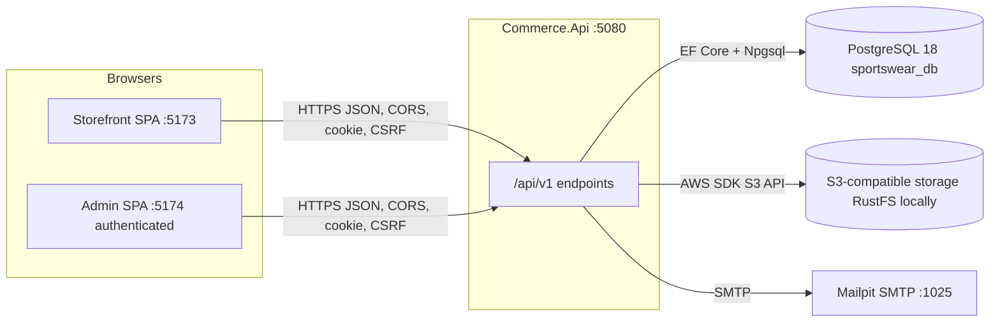
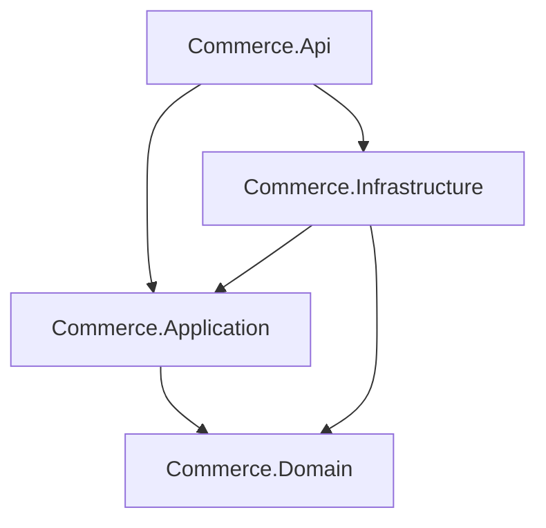
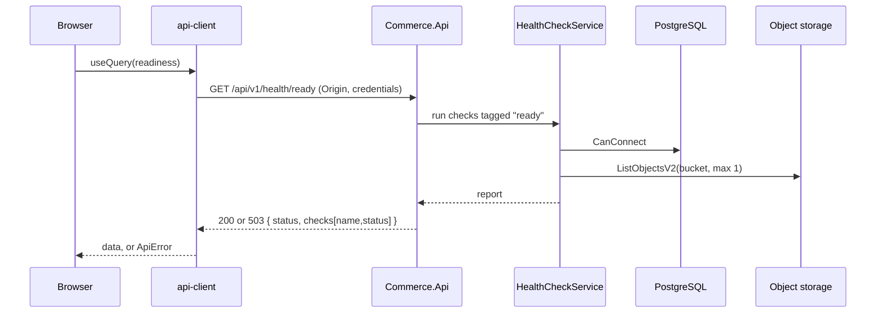
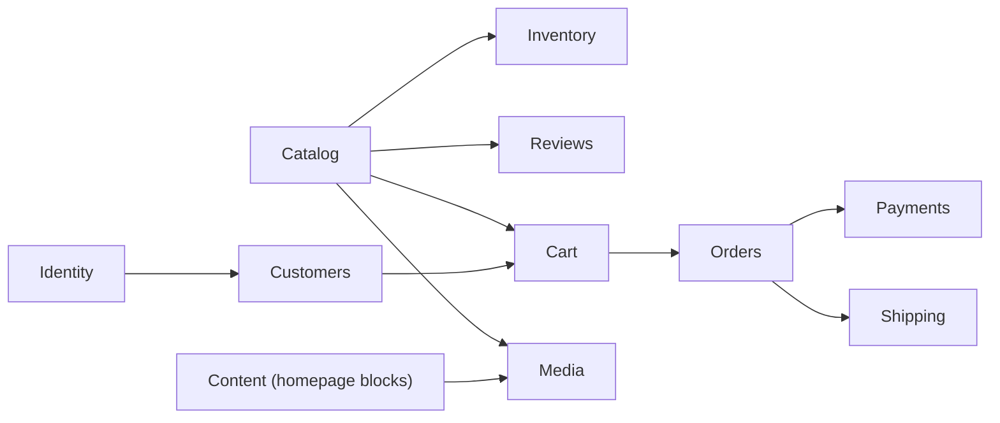

# Architecture

Sportswear Commerce is a **modular monolith** in a single monorepo. It has two independently
deployable React applications, one ASP.NET Core API, one PostgreSQL database and S3-compatible
object storage. It is designed so that a single developer can understand and change any part of it.

## System overview



- The browser apps only ever talk to the API. They never reach the database or object storage
  directly, and they never receive database or storage credentials.
- In development the API and the Vite apps run natively for fast reloads. PostgreSQL, object
  storage and Mailpit run in Docker Compose (OrbStack on macOS).

## Component responsibilities

| Component                 | Responsibility                                                                                                      |
| ------------------------- | ------------------------------------------------------------------------------------------------------------------- |
| `apps/storefront`         | Customer shop. Account, catalog browsing, and the published homepage. Checkout is not built.                        |
| `apps/admin`              | Back office. Sign-in is required. Catalog navigation stays disabled. Not a public site.                             |
| `packages/ui`             | Shared design tokens plus primitives (`Button`, `TextField`, `Drawer`, and others).                                 |
| `packages/api-client`     | Typed `fetch` wrapper, in-memory CSRF token, and identity, catalog and homepage calls. Never stores session tokens. |
| `packages/content`        | Presentational homepage renderer. It does not fetch. Admin preview passes the public document in.                   |
| `packages/shared-types`   | TypeScript types generated from the API's OpenAPI document.                                                         |
| `Commerce.Api`            | Composition root: HTTP endpoints, cookie auth, CSRF, rate limits, OpenAPI, CORS, error handling.                    |
| `Commerce.Application`    | Identity and catalog use cases, plus the catalog and object-storage ports. No EF Core types.                        |
| `Commerce.Domain`         | Identity and catalog entities, slug, money, SKU and publish rules. No EF attributes.                                |
| `Commerce.Infrastructure` | EF Core `CommerceDbContext`, password hasher, SMTP, seeds, catalog queries and S3 storage.                          |

## Monorepo structure

```text
.
├── apps/
│   ├── storefront/            Vite + React app (port 5173)
│   └── admin/                 Vite + React app (port 5174)
├── packages/
│   ├── ui/                    Design tokens (styles.css) and primitives
│   ├── api-client/            createApiClient, ApiError
│   └── shared-types/          Generated OpenAPI types (src/generated)
├── backend/
│   ├── src/                   Commerce.Api | Application | Domain | Infrastructure
│   ├── tests/                 Commerce.UnitTests | Commerce.IntegrationTests
│   ├── Directory.Build.props  Shared build settings (net10.0, nullable, warnings as errors)
│   ├── Directory.Packages.props  Central NuGet package versions
│   └── Commerce.slnx
├── infrastructure/docker/     Scripts mounted into Compose services
├── scripts/                   Developer scripts (API user-secrets setup)
├── docs/
├── docker-compose.yml         PostgreSQL, object storage and Mailpit for local development
├── global.json                .NET SDK pin and test runner
├── nuget.config               nuget.org only, with package source mapping
└── package.json               npm workspaces and root scripts
```

Each app's `src/` is organised the same way:

| Folder        | Contents                                                                  |
| ------------- | ------------------------------------------------------------------------- |
| `app/`        | Root `App`, providers (TanStack Query) and app-level tests.               |
| `routes/`     | Route objects, the browser router and navigation configuration.           |
| `components/` | App-specific shared components, including `layout/`.                      |
| `features/`   | Feature modules (hooks, components, API calls) such as `system-status/`.  |
| `pages/`      | Route-level page components (lazy-loaded where useful).                   |
| `lib/`        | Environment validation, API client instance and the query client factory. |
| `styles/`     | The app's Tailwind entry point and theme overrides.                       |
| `test/`       | Vitest setup.                                                             |

A `hooks/` folder is reserved for cross-feature hooks. It will be created when the first one exists.

## Backend dependency direction



- `Commerce.Domain` references nothing, not even EF Core or ASP.NET Core.
- `Commerce.Application` references only `Commerce.Domain` among Commerce projects. It may use logging
  abstractions. It must not reference EF Core, Npgsql, the AWS SDK or ASP.NET Core.
- `Commerce.Infrastructure` implements Application interfaces and never references the API.
- `Commerce.Api` is the only composition root.

`Commerce.UnitTests/Architecture/DependencyDirectionTests.cs` enforces these rules.

The project deliberately has no MediatR, no CQRS framework, no generic repositories and no event
bus. `IdentityService` is a plain application service called from minimal API endpoints.

## Request flow and API conventions



- **Versioning.** All endpoints live under `/api/v1`.
- **Health.**
  - `GET /api/v1/health` is liveness. It never touches dependencies.
  - `GET /api/v1/health/ready` is readiness. It returns 503 when any dependency is unhealthy, and
    reports only check names and statuses, never errors or connection details.
- **Errors.** RFC 9457 ProblemDetails (`application/problem+json`) with a `traceId`, produced by
  `AddProblemDetails`, `UseStatusCodePages` and `GlobalExceptionHandler`. Exception messages are
  shown only in Development, and are always logged server-side.
- **CORS.** A single named policy uses the explicit origins in `Cors:AllowedOrigins` and allows
  credentials. Wildcards and malformed origins fail startup validation.
- **OpenAPI.**
  - The built-in `Microsoft.AspNetCore.OpenApi` serves `/openapi/v1.json`, and Scalar serves
    interactive docs at `/scalar`. Both are available in Development only.
  - Frontend types are generated from that document with `npm run api:types`.
- **Logging.** The built-in logger writes single-line console output in Development and JSON in
  other environments. HTTP request logging records method, path, status and duration only, never
  bodies or headers.
- **Configuration.**
  - Configuration is layered: `appsettings.json`, then `appsettings.{Environment}.json`, then
    user secrets (Development only), then environment variables.
  - Options are validated when the host starts, so a missing connection string or bucket stops the
    API with a clear message.

## Frontend architecture

- **Mobile-first and independently deployable.** Each app is a static SPA built by Vite and
  deployed on its own.
- **Data fetching.**
  - TanStack Query manages server state, and the shared `api-client` performs requests.
  - `ApiError` normalises HTTP errors, network failures and malformed responses into one type.
  - Aborts pass through untouched.
- **Authentication.**
  - The session is an opaque HttpOnly cookie (`cide-session` on local HTTP, `__Host-cide-session`
    in production). The database stores only a SHA-256 hash of the cookie value.
  - The client sends `credentials: 'include'`. It loads a CSRF token from `GET /api/v1/auth/csrf`
    into module memory and attaches `X-CSRF-TOKEN` on later requests. It does not use
    `localStorage` or `sessionStorage`.
  - Customer and admin logins are separate endpoints. A customer session that calls an admin
    endpoint receives 403. Frontend route guards are not the security boundary.
  - Production assumes one registrable domain for the shop, admin and API. `SameSite=Lax` host-only
    cookies are not sent to a cross-site API.
- **Environment.**
  - Each app validates `import.meta.env` with Zod at startup.
  - Only public `VITE_` values exist, and today that is just `VITE_API_BASE_URL`.
- **State.** The bag is server state loaded with TanStack Query. There is no client cart store.
- **Forms.** React Hook Form with the Zod resolver. Identity forms are one column and `max-w-md`.

## Design system and responsive strategy

- **Tokens.**
  - `packages/ui/src/styles/styles.css` defines neutral, brand-free tokens in a Tailwind v4 `@theme`
    block: colors, typography, spacing, radius, shadows, breakpoints and the focus ring.
  - Each app imports them and overrides any token in its own `src/styles/index.css`, so the
    storefront and admin can be themed independently.
- **Breakpoints.** Development is mobile-first, using Tailwind's standard scale.

  | Token | Width       | Reference device           |
  | ----- | ----------- | -------------------------- |
  | base  | under 640px | Phones (375px verified)    |
  | `sm`  | 640px       | Large phones               |
  | `md`  | 768px       | Tablets (verified)         |
  | `lg`  | 1024px      | Laptops (verified)         |
  | `xl`  | 1280px      | Desktops (1440px verified) |
  | `2xl` | 1536px      | Wide screens               |

- **Patterns established in Phase 1 for later phases to reuse:**
  - `Container` sets the page width and responsive gutters: `px-4`, then `sm:px-6`, then `lg:px-8`.
  - `Drawer` is a modal side panel on the native `<dialog>`, with focus trapping, Escape to close,
    an inert background, backdrop click to close and scroll locking. It powers the storefront
    mobile menu and the admin mobile sidebar. It is the intended base for filter and sort drawers
    and the mini cart.
  - The storefront header collapses its navigation into the drawer below `lg`.
  - The admin sidebar is persistent at `lg` and above. Below that it moves into the drawer.
  - Dashboard cards use a responsive grid: one column on mobile, then `md:grid-cols-2`, then
    `xl:grid-cols-3`.
  - Interactive controls are at least 44x44px (`size-11` or `min-h-11`).
  - Body text is at least 14px on mobile. 12px is reserved for uppercase eyebrow labels.
  - Safe-area insets are respected in the header, footer and drawers. Main content uses
    `min-w-0` so it can't force horizontal scrolling.
- **Conventions for later phases:**
  - Product grids start at two columns on mobile and grow at `md`, `lg` and `xl`.
  - Images use `srcset` and `sizes` with lazy loading.
  - Admin data tables sit in an `overflow-x-auto` wrapper, or switch to stacked cards below `md`.
  - Forms are single-column on mobile.

## Database integration

- PostgreSQL 18 is the only relational database. Locally it runs in Docker Compose, with the
  database `sportswear_db` bound to `127.0.0.1:${POSTGRES_PORT}`.
- `CommerceDbContext` lives in `Commerce.Infrastructure/Persistence`.
  - Entity configurations are discovered with `ApplyConfigurationsFromAssembly`.
  - Table and column names are snake_case through `EFCore.NamingConventions`.
  - Migrations live in `Persistence/Migrations`. The API does not call `Database.Migrate()` on startup.
- Design-time tooling (`dotnet ef`) uses `Commerce.Api` as the startup project, so it shares the
  API's configuration and user secrets. No design-time factory is needed.
- Identity tables: `users`, `roles`, `user_roles`, `auth_sessions`, `email_verification_tokens`,
  `password_reset_tokens`, `security_events`. Passwords use ASP.NET Core's `PasswordHasher<User>`.
  The schema is not the `AspNet*` Identity tables. Orders live in the additive `Commerce`
  migration: `carts`, `cart_items`, `orders`, `order_items`, `order_addresses`,
  `order_status_history`, `order_submissions`, `order_access_tokens`, and `email_outbox`.
- Catalog tables live in the `Catalog` migration and do not alter identity tables. Prices are
  `numeric(12,2)` on variants only. A stored `tsvector` uses the PostgreSQL `turkish` configuration.
  A trigger rejects category parent cycles.

## Catalog and inventory

Categories, collections, products, options, variants, balances, movements, media metadata and slug
history are one module. Color and size are option names, not columns. A variant's `combination_key`
is the sorted option-value ids, unique per product. A product with no options has one variant whose
key is empty.

Prices are tax-inclusive TRY (KDV included). JSON money is a decimal string plus `"currency": "TRY"`.
An active variant price must be greater than zero. `compare_at_price` is null or strictly greater
than `price`. `currency_code` is constrained to `TRY`. The public list price is the minimum active
variant price.

`inventory_balances` stores `on_hand` and `reserved`. Available quantity is `on_hand - reserved`.
There is no second reservation ledger. Manual adjustments lock one balance with
`SELECT … FOR UPDATE`. Checkout locks the requested balances in variant-id order, increases
`reserved`, and writes a `Reservation` movement (`quantity_delta` 0, `reserved_delta` positive).
Cancellation and expiration each write one `ReservationRelease` and decrease `reserved` once.
The initial order status is `paymentpending`. Nothing in Phase 6 sets `paid`. A future payment
webhook may set `paid` only while the order is still `paymentpending` and `expires_at` is in the
future. After expiration, a late payment must not restore the order. The maintenance worker expires
due orders and sends the email outbox outside the order transaction. Delivery is at-least-once.
SMTP acceptance is not exactly-once.

Slugs are unique per entity type. Turkish characters fold to ASCII. Changing a slug stores the
previous value in `slug_histories`. A public GET by an old slug returns the current entity. The
response `slug` is the current one. The API does not send HTTP 301.

Publishing requires a name, slug, short description, description, at least one active category, at
least one active variant with a valid SKU and price, a complete unique combination, and one primary
image with alt text. Stock may be zero. The first publish sets `PublishedAt`. Later archive and
publish cycles keep that timestamp. Products are archived, not hard-deleted.

`products.version` starts at 1. Merchandising writes increment it in the same database transaction
with `UPDATE … WHERE version = expected RETURNING version` when the client sends `expectedVersion`.
A mismatch returns 409 and writes nothing. Leaving the field out keeps the previous last-write-wins
behavior. Stock adjustments keep their own row lock and idempotency key and do not change this
version.

## Homepage content

`content_pages` stores the homepage key, draft revision pointer, published revision pointer,
`published_at` and `draft_version`. `content_revisions` and `content_revision_media` are insert-only.
Triggers reject update and delete. Saving a draft inserts a revision and advances `draft_version`.
Publishing points `published_revision_id` at the current draft and sets `published_at`. It does not
modify the revision. Public `GET /api/v1/content/homepage` reads only the published revision, drops
hidden blocks, and uses `Cache-Control: public, max-age=30`. Before the first publish the response
is `{ "publishedAt": null, "blocks": [] }`.

A content image is public only while `content_revision_media.revision_id` equals the page's
`published_revision_id`. Replacing a homepage that still references the image keeps it public.
Removing it makes the public GET 404. The admin GET stays available. Objects are not deleted.

## Object storage integration

- **S3 API only.** The API talks to storage solely through the S3 API (`AWSSDK.S3`), so any
  S3-compatible provider works: AWS S3, Cloudflare R2, DigitalOcean Spaces, Backblaze B2 and others.
- **Local service.** Development uses RustFS 1.0.4 (Apache-2.0). MinIO, the usual choice, no
  longer publishes container images.
- **Bucket creation.** A one-shot `amazon/aws-cli` container creates the bucket.
- **Configuration.**
  - `ObjectStorage` options: `ServiceUrl` (leave empty for AWS), `Region`, `BucketName`,
    `AccessKey` and `SecretKey`, plus `ForcePathStyle` (`true` for RustFS and MinIO).
  - Leave the keys empty to use the AWS default credential chain, for example IAM roles.
- **Client.** The S3 client calculates checksums only when required, for compatibility with
  S3-compatible services.
- **Catalog media.** `IObjectStorage` is the Application port. Infrastructure implements it with
  the S3 client against the private `sportswear-media` bucket. The admin uploads JPEG, PNG or WebP
  (detected from the file signature, at most 5 MiB) to the API. The API writes
  `catalog/{productId}/{mediaId}.{ext}` and streams reads back. The browser never receives a
  storage credential or a public object URL. Public `GET /api/v1/media/{id}` streams an image only
  when the product is `Active` and, for a variant image, that variant is active. Public media uses
  `Cache-Control: public, max-age=86400, immutable` because the bytes for an id never change.
  Admin media uses `Cache-Control: private, no-store`. Homepage images use
  `content/{mediaId}.{ext}`. The admin origin loads unpublished images with a credentialed fetch
  and an object URL, because a cross-origin `` does not send the session cookie. Phase 5 will
  add private WebP siblings at 480, 960 and 1600 pixels and a `w` query on the same GET routes.
  Phase 5 adds private WebP siblings at 480, 960 and 1600 pixels with SkiaSharp 4.155.0 (MIT), plus the Linux native asset package so a Linux host can encode. ImageSharp is not used: 2.1 is outside security support, and current releases need a Six Labors license key. A derivative is listed in `sources` only after its object is stored. `GET` with an allowed missing `w` returns the original for five minutes. The storefront builds `srcset` only from advertised sources. Unknown dimensions and failed encodes keep the original and add no sibling.

  Public catalog documents (home, shop, category, collection, and product) are rendered by a Node process with Vite SSR. The HTML includes the title, description, canonical URL, and a `type="application/json"` payload. That payload escapes `<`, `>`, `&`, U+2028, and U+2029 so a product name cannot close the script. The browser hydrates the same markup, then loads the interactive app. The Node process calls the public API without cookies or credentials. Catalog HTML is `Cache-Control: private, no-store`. Account, cart, checkout, confirmation, and search stay client-rendered and `noindex`. If the API is unavailable, the Node process returns 503 rather than an empty catalog. `GET /health/ready` on that process checks API readiness.

  Public `minPrice` and `maxPrice` still match any active variant. `priceBasis=from` applies both bounds to the displayed minimum active price. The storefront sends `from` for listings and facets.

## Future module boundaries

Business modules are vertical slices inside each backend project, for example
`Commerce.Domain/Catalog`, `Commerce.Application/Catalog` and `Commerce.Api/Endpoints/Catalog`.
Modules share one database, but they own their tables and talk to each other through Application
services rather than through each other's tables.



| Module    | Owns                                                                               |
| --------- | ---------------------------------------------------------------------------------- |
| Identity  | Customers and administrators, sessions, verification, reset and security events.   |
| Catalog   | Products, variants, categories, collections, media metadata and slug history.      |
| Inventory | Per-variant balances and the append-only movement ledger. Reservations come later. |
| Customers | Profiles, addresses and wishlists.                                                 |
| Cart      | Carts and line items.                                                              |
| Orders    | Orders, order lines and status history.                                            |
| Payments  | Payment provider integration (provider not chosen yet).                            |
| Shipping  | Configurable shipping rules and rates.                                             |
| Reviews   | Verified-purchase reviews.                                                         |
| Content   | Homepage block editor content.                                                     |
| Media     | Uploaded images and asset metadata in object storage.                              |
