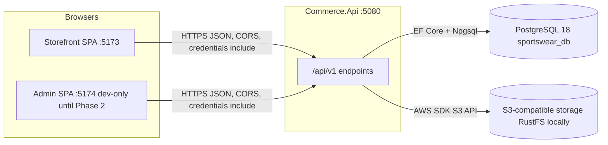
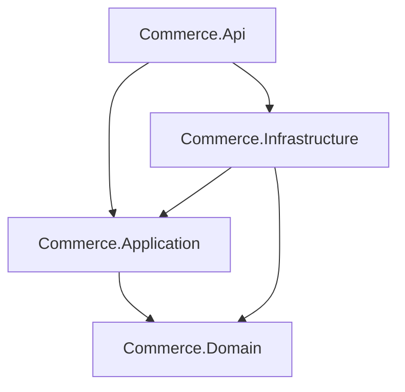
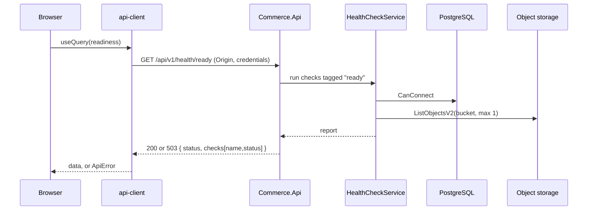
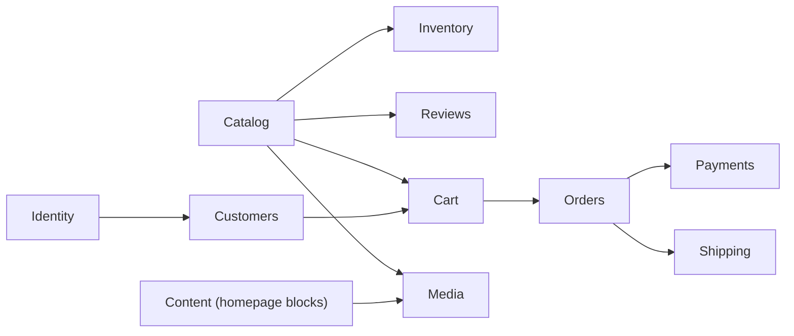

# Architecture

Sportswear Commerce is a **modular monolith** in a single monorepo. It has two independently
deployable React applications, one ASP.NET Core API, one PostgreSQL database and S3-compatible
object storage. It is designed so that a single developer can understand and change any part of it.

## System overview



- The browser apps only ever talk to the API. They never reach the database or object storage
  directly, and they never receive database or storage credentials.
- In development the API and the Vite apps run natively for fast reloads. PostgreSQL and object
  storage run in Docker Compose (OrbStack on macOS).

## Component responsibilities

| Component                 | Responsibility                                                                                    |
| ------------------------- | ------------------------------------------------------------------------------------------------- |
| `apps/storefront`         | Customer-facing shop: browsing, cart, checkout, account (from later phases).                      |
| `apps/admin`              | Back office: catalogue, inventory, orders, content. Must not be deployed until Phase 2 adds auth. |
| `packages/ui`             | Shared design tokens and a small set of UI primitives used by both apps.                          |
| `packages/api-client`     | Typed `fetch` wrapper: base URL, JSON, abort signals, error normalization, cookie-ready.          |
| `packages/shared-types`   | TypeScript types generated from the API's OpenAPI document.                                       |
| `Commerce.Api`            | Composition root: HTTP endpoints, middleware, configuration, OpenAPI, CORS, error handling.       |
| `Commerce.Application`    | Use cases and application-level interfaces (empty until Phase 2).                                 |
| `Commerce.Domain`         | Entities, value objects and business rules (empty until Phase 2).                                 |
| `Commerce.Infrastructure` | EF Core `CommerceDbContext`, S3 client, health checks and other external integrations.            |

## Monorepo structure

```text
.
├── apps/
│   ├── storefront/            Vite + React app (port 5173)
│   └── admin/                 Vite + React app (port 5174)
├── packages/
│   ├── ui/                    Design tokens (styles.css) and primitives
│   ├── api-client/            createApiClient, ApiError
│   └── shared-types/          Generated OpenAPI types (src/generated)
├── backend/
│   ├── src/                   Commerce.Api | Application | Domain | Infrastructure
│   ├── tests/                 Commerce.UnitTests | Commerce.IntegrationTests
│   ├── Directory.Build.props  Shared build settings (net10.0, nullable, warnings as errors)
│   ├── Directory.Packages.props  Central NuGet package versions
│   └── Commerce.slnx
├── infrastructure/docker/     Scripts mounted into Compose services
├── scripts/                   Developer scripts (API user-secrets setup)
├── docs/
├── docker-compose.yml         PostgreSQL + object storage for local development
├── global.json                .NET SDK pin and test runner
├── nuget.config               nuget.org only, with package source mapping
└── package.json               npm workspaces and root scripts
```

Each app's `src/` is organised the same way:

| Folder        | Contents                                                                  |
| ------------- | ------------------------------------------------------------------------- |
| `app/`        | Root `App`, providers (TanStack Query) and app-level tests.               |
| `routes/`     | Route objects, the browser router and navigation configuration.           |
| `components/` | App-specific shared components, including `layout/`.                      |
| `features/`   | Feature modules (hooks, components, API calls) such as `system-status/`.  |
| `pages/`      | Route-level page components (lazy-loaded where useful).                   |
| `lib/`        | Environment validation, API client instance and the query client factory. |
| `styles/`     | The app's Tailwind entry point and theme overrides.                       |
| `test/`       | Vitest setup.                                                             |

A `hooks/` folder is reserved for cross-feature hooks. It will be created when the first one exists.

## Backend dependency direction



- `Commerce.Domain` references nothing, not even EF Core or ASP.NET Core.
- `Commerce.Application` references only `Commerce.Domain`.
- `Commerce.Infrastructure` implements Application interfaces and never references the API.
- `Commerce.Api` is the only composition root.

`Commerce.UnitTests/Architecture/DependencyDirectionTests.cs` enforces these rules.

The project deliberately has no MediatR, no CQRS framework, no generic repositories and no event
bus. Use cases will be plain application services called from minimal API endpoints.

## Request flow and API conventions



- **Versioning.** All endpoints live under `/api/v1`.
- **Health.**
  - `GET /api/v1/health` is liveness. It never touches dependencies.
  - `GET /api/v1/health/ready` is readiness. It returns 503 when any dependency is unhealthy, and
    reports only check names and statuses, never errors or connection details.
- **Errors.** RFC 9457 ProblemDetails (`application/problem+json`) with a `traceId`, produced by
  `AddProblemDetails`, `UseStatusCodePages` and `GlobalExceptionHandler`. Exception messages are
  shown only in Development, and are always logged server-side.
- **CORS.** A single named policy uses the explicit origins in `Cors:AllowedOrigins` and allows
  credentials. Wildcards and malformed origins fail startup validation.
- **OpenAPI.**
  - The built-in `Microsoft.AspNetCore.OpenApi` serves `/openapi/v1.json`, and Scalar serves
    interactive docs at `/scalar`. Both are available in Development only.
  - Frontend types are generated from that document with `npm run api:types`.
- **Logging.** The built-in logger writes single-line console output in Development and JSON in
  other environments. HTTP request logging records method, path, status and duration only, never
  bodies or headers.
- **Configuration.**
  - Configuration is layered: `appsettings.json`, then `appsettings.{Environment}.json`, then
    user secrets (Development only), then environment variables.
  - Options are validated when the host starts, so a missing connection string or bucket stops the
    API with a clear message.

## Frontend architecture

- **Mobile-first and independently deployable.** Each app is a static SPA built by Vite and
  deployed on its own.
- **Data fetching.**
  - TanStack Query manages server state, and the shared `api-client` performs requests.
  - `ApiError` normalises HTTP errors, network failures and malformed responses into one type.
  - Aborts pass through untouched.
- **Authentication readiness.**
  - The client sends `credentials: 'include'` and exposes a `prepareHeaders` hook (for a future
    CSRF token).
  - It never stores tokens. Phase 2 will use HttpOnly, Secure, SameSite cookies issued by the API.
  - For cookies to work in production, host the apps and the API on the same site (for example
    `shop.example.com`, `admin.example.com` and `api.example.com`).
- **Environment.**
  - Each app validates `import.meta.env` with Zod at startup.
  - Only public `VITE_` values exist, and today that is just `VITE_API_BASE_URL`.
- **State.** Zustand will be added for client-only state such as the cart when that phase begins.
- **Forms.** React Hook Form arrives with the first form. Zod is already present.

## Design system and responsive strategy

- **Tokens.**
  - `packages/ui/src/styles/styles.css` defines neutral, brand-free tokens in a Tailwind v4 `@theme`
    block: colors, typography, spacing, radius, shadows, breakpoints and the focus ring.
  - Each app imports them and overrides any token in its own `src/styles/index.css`, so the
    storefront and admin can be themed independently.
- **Breakpoints.** Development is mobile-first, using Tailwind's standard scale.

  | Token | Width       | Reference device           |
  | ----- | ----------- | -------------------------- |
  | base  | under 640px | Phones (375px verified)    |
  | `sm`  | 640px       | Large phones               |
  | `md`  | 768px       | Tablets (verified)         |
  | `lg`  | 1024px      | Laptops (verified)         |
  | `xl`  | 1280px      | Desktops (1440px verified) |
  | `2xl` | 1536px      | Wide screens               |

- **Patterns established in Phase 1 for later phases to reuse:**
  - `Container` sets the page width and responsive gutters: `px-4`, then `sm:px-6`, then `lg:px-8`.
  - `Drawer` is a modal side panel on the native `<dialog>`, with focus trapping, Escape to close,
    an inert background, backdrop click to close and scroll locking. It powers the storefront
    mobile menu and the admin mobile sidebar. It is the intended base for filter and sort drawers
    and the mini cart.
  - The storefront header collapses its navigation into the drawer below `lg`.
  - The admin sidebar is persistent at `lg` and above. Below that it moves into the drawer.
  - Dashboard cards use a responsive grid: one column on mobile, then `md:grid-cols-2`, then
    `xl:grid-cols-3`.
  - Interactive controls are at least 44x44px (`size-11` or `min-h-11`).
  - Body text is at least 14px on mobile. 12px is reserved for uppercase eyebrow labels.
  - Safe-area insets are respected in the header, footer and drawers. Main content uses
    `min-w-0` so it can't force horizontal scrolling.
- **Conventions for later phases:**
  - Product grids start at two columns on mobile and grow at `md`, `lg` and `xl`.
  - Images use `srcset` and `sizes` with lazy loading.
  - Admin data tables sit in an `overflow-x-auto` wrapper, or switch to stacked cards below `md`.
  - Forms are single-column on mobile.

## Database integration

- PostgreSQL 18 is the only relational database. Locally it runs in Docker Compose, with the
  database `sportswear_db` bound to `127.0.0.1:${POSTGRES_PORT}`.
- `CommerceDbContext` lives in `Commerce.Infrastructure/Persistence`.
  - Entity configurations are discovered with `ApplyConfigurationsFromAssembly`.
  - Migrations will live in `Persistence/Migrations`, inside the Infrastructure assembly.
- Design-time tooling (`dotnet ef`) uses `Commerce.Api` as the startup project, so it shares the
  API's configuration and user secrets. No design-time factory is needed.
- Phase 1 has no entities and no migrations.

## Object storage integration

- **S3 API only.** The API talks to storage solely through the S3 API (`AWSSDK.S3`), so any
  S3-compatible provider works: AWS S3, Cloudflare R2, DigitalOcean Spaces, Backblaze B2 and others.
- **Local service.** Development uses RustFS 1.0.4 (Apache-2.0). MinIO, the usual choice, no
  longer publishes container images.
- **Bucket creation.** A one-shot `amazon/aws-cli` container creates the bucket.
- **Configuration.**
  - `ObjectStorage` options: `ServiceUrl` (leave empty for AWS), `Region`, `BucketName`,
    `AccessKey` and `SecretKey`, plus `ForcePathStyle` (`true` for RustFS and MinIO).
  - Leave the keys empty to use the AWS default credential chain, for example IAM roles.
- **Client.** The S3 client calculates checksums only when required, for compatibility with
  S3-compatible services.
- **Deferred.** No storage abstraction, upload endpoints or presigned URLs exist yet. They arrive
  with the media library.

## Future module boundaries

Business modules are vertical slices inside each backend project, for example
`Commerce.Domain/Catalog`, `Commerce.Application/Catalog` and `Commerce.Api/Endpoints/Catalog`.
Modules share one database, but they own their tables and talk to each other through Application
services rather than through each other's tables.



| Module    | Owns                                                                |
| --------- | ------------------------------------------------------------------- |
| Identity  | Admin and customer authentication (ASP.NET Core Identity, cookies). |
| Catalog   | Products, variants, categories, collections.                        |
| Inventory | Stock levels and reservations.                                      |
| Customers | Profiles, addresses and wishlists.                                  |
| Cart      | Carts and line items.                                               |
| Orders    | Orders, order lines and status history.                             |
| Payments  | Payment provider integration (provider not chosen yet).             |
| Shipping  | Configurable shipping rules and rates.                              |
| Reviews   | Verified-purchase reviews.                                          |
| Content   | Homepage block editor content.                                      |
| Media     | Uploaded images and asset metadata in object storage.               |
